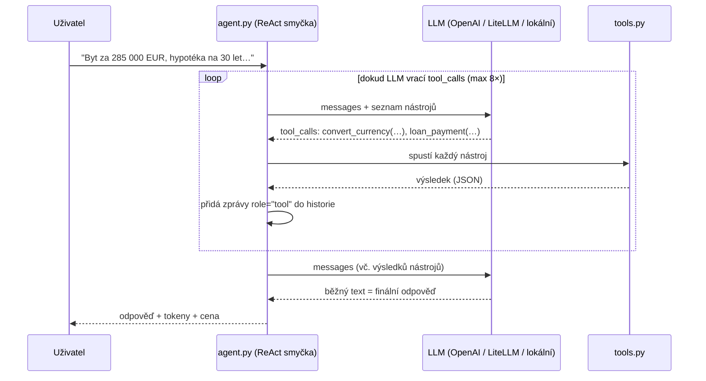
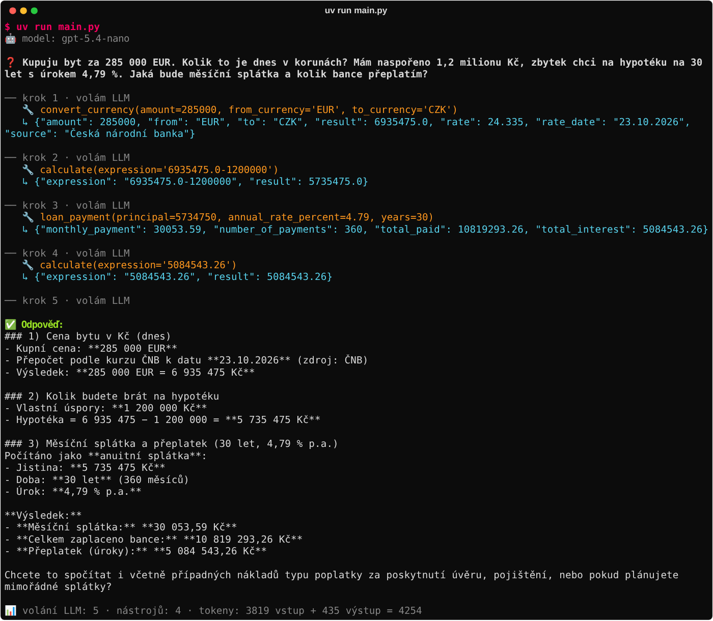
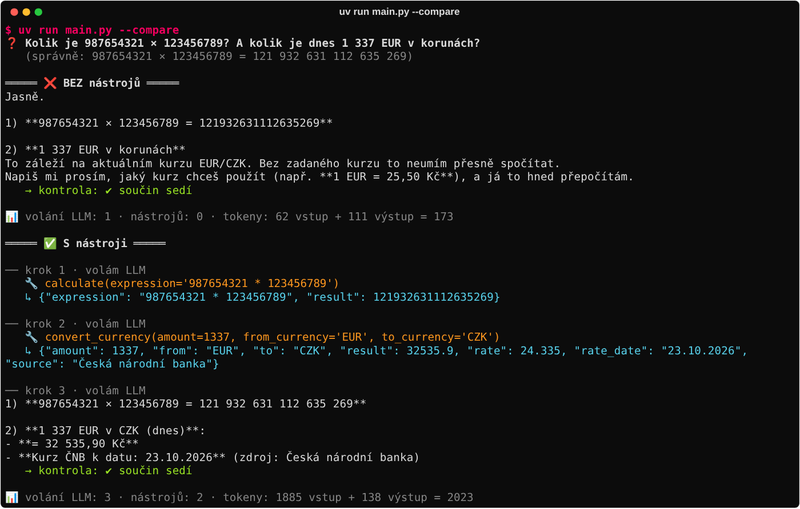

# Úkol 1 – LLM API + tool calling (ReAct agent)


> **Zadání:** Napiš Python skript, který zavolá LLM API, použije nástroj (např. výpočetní funkci) a vrátí odpověď zpět LLM.

**Řešení v jedné větě:** agent, který na otázky o penězích nikdy nepočítá z hlavy. Výpočty, kurzy a splátky dělá nástroji a výsledky vrací modelu, dokud nemá finální odpověď.

```bash
cp .env.example .env        # doplň OPENAI_API_KEY
uv run main.py              # ukázkový dotaz
uv run pytest               # 28 testů, nepotřebují API klíč
```

---

## Co se tu děje



| Soubor | Co dělá |
|---|---|
| [`agent.py`](agent.py) | **Jádro úkolu.** ReAct smyčka (~60 řádků logiky): volání LLM → `tool_calls` → spuštění nástrojů → zprávy `role: "tool"` → znovu, dokud nepřijde text. Počítá tokeny. |
| [`tools.py`](tools.py) | 3 nástroje + jejich JSON schémata pro LLM. |
| [`main.py`](main.py) | CLI: jeden dotaz, `--chat`, `--compare`. |
| [`tests/`](tests) | Testy nástrojů i celé smyčky s falešným LLM. |
| [`litellm/`](litellm) | AI gateway v Dockeru (volitelně). |

### Nástroje

| Nástroj | Proč ho LLM potřebuje |
|---|---|
| `calculate(expression)` | LLM předpovídá tokeny a nepočítá. U velkých čísel se často splete (viz `--compare`). Výraz se vyhodnotí **bezpečně přes AST**, ne přes `eval()`, takže `__import__('os')…` neprojde. Je tu i ochrana proti `9**9**9**9`. |
| `convert_currency(amount, from, to)` | **Živá data**, která model z tréninku znát nemůže. Bere **dnešní kurz ČNB** (stejný princip jako cena akcie v lekci, jen s českým zdrojem bez API klíče). |
| `loan_payment(principal, rate, years)` | Anuitní splátka hypotéky, celkem zaplaceno a přeplatek. Typický vícekrokový výpočet, ve kterém modely bez nástroje chybují. |

## Spuštění

Potřebuješ [uv](https://docs.astral.sh/uv/) a OpenAI API klíč.

```bash
cp .env.example .env                 # doplň OPENAI_API_KEY

uv run main.py                       # ukázka: byt v EUR → CZK → hypotéka (3 nástroje)
uv run main.py "Kolik je 21 % DPH z 3 499 USD v korunách?"
uv run main.py --chat                # chat s pamětí, po každé odpovědi vidíš růst tokenů
uv run main.py --compare             # stejný dotaz BEZ nástrojů vs. S nástroji
uv run pytest -v                     # testy bez API klíče a bez internetu
```

### Skutečný výstup (`gpt-5.4-nano`, 23. 10. 2026)





### Co jsem z běhů zjistil

1. **Nástroj počítá přesně, ale argumenty pořád opisuje LLM a může se splést.** V kroku 2 vyšla jistina `5735475`. Model ji ale do `loan_payment` předal jako `5734750` (přehozené cifry). Splátka tak vyšla o 3,80 Kč nižší a přeplatek o 642,80 Kč nižší. Ve finální odpovědi přitom tvrdí jistinu 5 735 475 Kč. Správně je **30 057,39 Kč** měsíčně a přeplatek **5 085 186,06 Kč**. Ponaučení: tool calling odstraní chyby ve *výpočtu*, ne v *přenosu dat mezi kroky*. Řešení: méně kroků přes LLM, tedy nástroj, který bere cenu i úspory a rozdíl spočítá sám, nebo kontrolu argumentů v kódu.
2. **Přísný system prompt má svou cenu.** Kvůli pravidlu „NIKDY nepočítej z hlavy“ si model v kroku 4 nechal „spočítat“ jedno číslo (`calculate('5084543.26')`). Bylo to jedno zbytečné kolo smyčky a další tokeny.
3. **Nástroj nepomáhá jen s matikou.** `gpt-5.4-nano` vynásobil 987654321 × 123456789 správně i bez nástroje. Dnešní kurz ale bez nástroje říct nedokázal. Hlavní hodnota nástrojů jsou **živá data**, která model z tréninku znát nemůže.
4. **Nástroje stojí tokeny.** Bez nástrojů 173 tokenů, s nástroji 2 023. Schéma nástrojů jde s každým requestem a historie se v každém kole posílá znovu celá.

## Tři způsoby, jak připojit model (kód se nemění)

Používá se **jen OpenAI klient**. Kam míří, se nastavuje v `.env` (proměnné `OPENAI_BASE_URL` a `MODEL`):

| Varianta | `.env` | Kdy |
|---|---|---|
| **A – přímo OpenAI** | `OPENAI_API_KEY=sk-…` | nejrychlejší start |
| **B – LiteLLM gateway** | `OPENAI_BASE_URL=http://localhost:4000` | doporučení z lekce: klíče, logy, tokeny a ceny na jednom místě |
| **C – lokální model** | `OPENAI_BASE_URL=http://localhost:1234/v1` | LM Studio / Unsloth Studio, data neopustí počítač |

### LiteLLM (varianta B)

```bash
cd litellm
cp .env.example .env          # sem patří skutečný OpenAI klíč, aplikace ho nikdy nevidí
docker compose up -d          # gateway na :4000, UI na http://localhost:4000/ui
```

V `.env` aplikace pak odkomentuj blok **Varianta B**. Každé volání agenta uvidíš v LiteLLM UI i s počtem tokenů a cenou.

## Na co jsem dbal (a proč)

- **Bezstavové API → historie se posílá celá.** `agent.messages` roste a v `--chat` je vidět, jak s každou otázkou rostou vstupní tokeny.
- **Požadavek modelu na nástroj jde do historie** (`role: "assistant"` s `tool_calls`) dřív než výsledky (`role: "tool"` se správným `tool_call_id`). Jinak API další volání odmítne.
- **Paralelní tool calls.** Když model pošle víc nástrojů naráz, spustí se všechny a teprve pak jde další volání LLM.
- **Chyba nástroje agenta neshodí.** `execute_tool` vrátí modelu `{"error": "ZeroDivisionError: …"}` a model může reagovat (opravit vstup, vysvětlit uživateli).
- **Pojistka `max_iterations`** proti nekonečné smyčce a vypálenému kreditu.
- **Málo nástrojů s dobrým `description`.** Seznam nástrojů jde s každým requestem a stojí tokeny. Popis je to, podle čeho se model rozhoduje.
- **Bezpečnost.** Žádné `eval()` na výstupu modelu. API klíč je jen v `.env` (v `.gitignore`), s LiteLLM jen v gateway.
- **Testy bez klíče.** `tests/test_agent.py` nahradí LLM falešným klientem a ověří celou smyčku: pořadí rolí, paralelní volání, návrat chyb, limit iterací i paměť historie. Běží v GitHub Actions.
